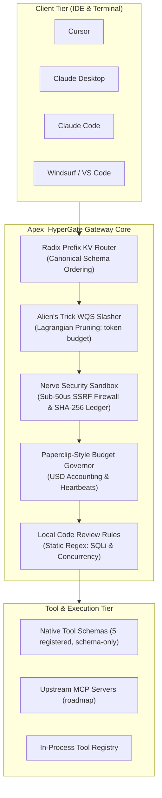

# Apex_HyperGate

[](https://opensource.org/licenses/Apache-2.0)
[](https://www.python.org/)
[-success.svg)](https://github.com/AAH20/apex-hypergate)
[](https://github.com/AAH20/apex-hypergate)
[](https://github.com/AAH20/apex-hypergate)
[-brightgreen.svg)](https://github.com/AAH20/apex-hypergate)

**Sovereign AI Agent Toolkit: MCP Schema Governance, Security Sandboxing & Deterministic Code Review**

Apex_HyperGate is an institutional-grade, pure-Python toolkit for enterprise AI developers and autonomous agent swarms. It unifies a **local Paperclip-style Company OS budget governor**, a **deterministic E2E testing framework**, a **local regex-based code review engine** (inspired by Alibaba Open Code Review), a sub-50µs-target security sandbox, a schema prefix canonicalizer, and Alien's Trick WQS schema token slashing. It is a library plus a CLI; it does not run a network daemon (see Roadmap).

Built with **strictly zero external dependencies** (pure Python standard library), Apex_HyperGate writes MCP client configuration JSON for **Cursor**, **Claude Desktop**, **Claude Code**, **Windsurf**, and **VS Code**. It does not yet establish a live MCP connection to those clients (see Roadmap).

---

## Architecture Overview



---

## Key Capabilities

- **Paperclip-Style Company OS Adapter (local implementation)**: Enforces discrete task lifecycles (`QUEUED`, `IN_PROGRESS`, `COMPLETED`, `BLOCKED`, `BUDGET_EXCEEDED`), USD token accounting, and generates SHA-256 `ActionLedger`-style receipts. This is a local reimplementation; it has no dependency on `@paperclipai/hermes-paperclip-adapter`.
- **Local Code Review Engine (inspired by Alibaba Open Code Review)**: A local deterministic regex engine detecting SQL injection (`ALIBABA-SEC-001`), hardcoded credentials (`ALIBABA-SEC-002`), global-state mutation (`ALIBABA-CONC-001`), and unclosed resources (`ALIBABA-RES-001`). It bundles no Alibaba code and reports no measured precision.
- **Deterministic E2E Testing Framework**: Test harness that executes an end-to-end multi-heartbeat agent scenario under a hard USD budget and security barrier.
- **Nerve Sub-50µs Security Sandbox**: Line-speed SSRF firewall blocking cloud metadata (`169.254.169.254`, `metadata.google.internal`), private RFC 1918 subnets, path traversals (`/etc/shadow`, `~/.ssh/id_rsa`), and destructive shell mutations (`rm -rf /`).
- **Alien's Trick WQS Token Slasher**: Lagrangian-relaxation knapsack optimizer that prunes redundant MCP schema definitions under a token budget (design target: 70%-85% reduction).
- **Radix-Trie Prefix KV-Cache Router**: Deterministically normalizes and sorts schema declarations into an invariant serialized form to maximize prompt-cache prefix stability. Cache hits are tracked in memory per session; there is no integration with any model provider, so no cross-provider hit rate is claimed.
- **Zero-Dependency Architecture**: 100% pure Python standard library. No native compilation, no third-party package vulnerabilities, zero supply-chain risk.

---

## Benchmarking

`hypergate benchmark` measures average per-call latency for four subsystems at runtime (Nerve sandbox inspection, Alien's Trick token slashing, local code review, and Radix schema canonicalization) on the machine where it runs. It reports those four averages only — there is no cumulative gateway metric and no committed benchmark artifact, so no fixed latency or throughput figures are published here. Run it yourself:

```bash
hypergate benchmark --iterations 100
```

---

## Quickstart & Installation

### Option 1: Install via Wheel or Pip

```bash
pip install apex-hypergate
```

### Option 2: Run directly with Python Standard Library (Zero Install)

```bash
git clone https://github.com/AAH20/apex-hypergate.git
cd apex-hypergate
python3 -m apex_hypergate.cli --help
```

---

## Client Configuration

`hypergate configure` writes MCP client configuration JSON for installed developer tools. It does not start a proxy or server:

```bash
# Write MCP client config JSON for Cursor, Claude Desktop, Claude Code, Windsurf, and VS Code
hypergate configure --port 8000
```

### Generated Configuration Block

For every supported client, `configure` writes the following block (there is no HTTP/SSE endpoint, so no `url` form is generated):

```json
{
  "mcpServers": {
    "apex-hypergate": {
      "command": "hypergate",
      "args": ["mcp-proxy", "--port", "8000"],
      "env": { "APEX_HYPERGATE_ENDPOINT": "http://127.0.0.1:8000/v1" }
    }
  }
}
```

> Note: the generated `mcp-proxy` subcommand does not exist yet, and `hypergate serve` is a placeholder that prints status and exits without binding a port. Live client transport and the HTTP/SSE endpoint are roadmap.

---

## Command-Line Interface (CLI)

```bash
# 1. Run microsecond latency benchmarks
hypergate benchmark --iterations 100

# 2. Run deterministic E2E integration test suite
hypergate e2e-test

# 3. Review a Git diff using the local code review engine
hypergate review --file changes.diff

# 4. Initialize the gateway daemon placeholder
#    (currently prints status and exits without binding a port; roadmap)
hypergate serve --port 8000
```

---

## Programmatic Python API

```python
from apex_hypergate.orchestrator import ApexHyperGateOrchestrator

# Initialize the orchestrator (only workspace_root is accepted)
orchestrator = ApexHyperGateOrchestrator(workspace_root="/path/to/workspace")

# 1. Prune tool schemas under a token budget and canonicalize the prompt prefix
tools, metrics = orchestrator.route_and_slash_tools(
    user_query="query enterprise relational storage",
    token_budget=2500,
    session_id="SESSION-1",
)
print("Pruned tools:", [t.name for t in tools])
print("KV-cache prefix hit:", metrics["kv_cache_hit"])

# 2. Run the security sandbox over a tool call
verdict = orchestrator.inspect_and_authorize_tool("view_file", {"path": "src/main.py"})
print("Safe:", verdict.is_safe, "Receipt:", verdict.receipt_hash)

# 3. Review a Git diff with the local code review engine
diff_text = """--- a/db.py
+++ b/db.py
@@ -1,2 +1,3 @@
 def q(uid):
+    cursor.execute(f\"SELECT * FROM users WHERE id = '{uid}'\")
     return None
"""
report = orchestrator.review_code_diff(diff_text)
for finding in report.findings:
    print(finding.severity.value, finding.rule_id, finding.file_path, finding.line_number)
```

Budget-governed task accounting uses the Paperclip-style adapter directly:

```python
from apex_hypergate.adapters.paperclip_adapter import HermesPaperclipAdapter

adapter = HermesPaperclipAdapter()
task = adapter.create_task(task_id="TASK-1", title="Refactor auth endpoint", usd_budget=0.10)

can_proceed, task, failure_reason = adapter.heartbeat_tick(
    task_id="TASK-1",
    prompt_tokens=320,
    completion_tokens=150,
    tool_action_name="view_file",
    tool_payload={"path": "src/auth.py"},
)
if not can_proceed:
    print("Halted:", failure_reason)
print("Status:", task.status.value, "Spent:", f"${task.consumed_usd:.4f}", "Remaining:", f"${task.remaining_usd:.4f}")

adapter.mark_task_complete("TASK-1")
print("Receipts:", len(task.receipts))
```

---

## Running Test Suite

Apex_HyperGate includes 15 deterministic unit and integration tests covering every subsystem:

```bash
python3 -m unittest discover tests -v
```

```text
test_alibaba_open_code_reviewer_concurrency_race ... ok
test_alibaba_open_code_reviewer_hardcoded_secrets ... ok
test_alibaba_open_code_reviewer_resource_leak ... ok
test_alibaba_open_code_reviewer_sqli_detection ... ok
test_aliens_trick_token_slashing ... ok
test_cli_commands ... ok
test_client_config_manager_injection ... ok
test_e2e_testing_suite_execution ... ok
test_hermes_paperclip_action_ledger_receipts ... ok
test_hermes_paperclip_adapter_budget_governance ... ok
test_nerve_sandbox_destructive_commands ... ok
test_nerve_sandbox_path_traversal ... ok
test_nerve_sandbox_ssrf_blocking ... ok
test_orchestrator_apex_ecosystem_tools_mounting ... ok
test_radix_prefix_kv_router_canonical_ordering ... ok

----------------------------------------------------------------------
Ran 15 tests in 0.007s

OK
```

---

## Roadmap (Not Yet Implemented)

The following are described by the codebase's naming/docstrings but are **not implemented**:

- **Network daemon / MCP transport**: `hypergate serve` prints status and exits without binding a port. There is no stdio, HTTP, SSE, or JSON-RPC MCP transport anywhere in the code.
- **HTTP/SSE endpoint** (`http://127.0.0.1:8000/v1/sse`) and the generated `hypergate mcp-proxy` subcommand: neither exists.
- **Live client connection**: `configure` only writes client JSON; no client is actually connected.
- **Subprocess MCP server management**: `MCPProcessSupervisor` tracks server metadata and imports `subprocess`, but never spawns a process; there is no health-check ping, auto-restart, or orphan handling.
- **External integrations**: no dependency on `@paperclipai/hermes-paperclip-adapter` and no use of Alibaba `open-code-review` code — both are local reimplementations.
- **Measured benchmarks / precision / cache-hit rates**: no committed benchmark artifact, no AACR-Bench evaluation, and no model-provider KV-cache integration.

---

## Documentation

- [Enterprise & Commercial Specification](docs/COMMERCIAL_SPEC.md)
- [Hermes Paperclip Adapter & Company OS Integration](docs/PAPERCLIP_INTEGRATION.md)
- [Alibaba Open Code Review (`ocr`) Integration](docs/ALIBABA_OCR_INTEGRATION.md)

---

## License

Apex_HyperGate is licensed under the [Apache 2.0 License](LICENSE).
