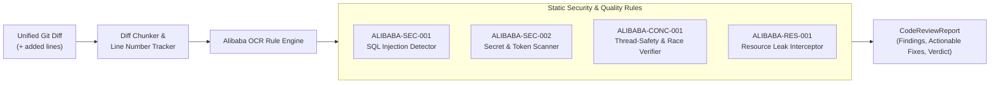
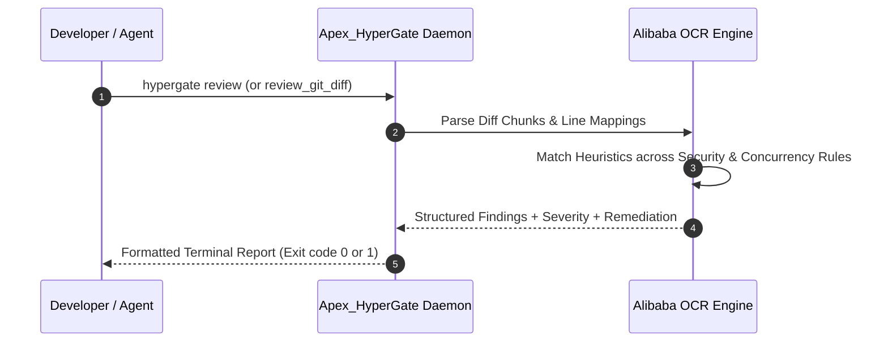

# Alibaba Open Code Review (`ocr`) Integration

## 1. Overview & AACR-Bench Architecture

Alibaba Open Code Review (`alibaba/open-code-review`) is an automated code review framework introduced by Alibaba Group. Apex_HyperGate does **not** bundle, import, or invoke any Alibaba code; the engine described here is a **local, deterministic reimplementation** of the same idea: replace the hallucinations and unpredictable token costs of pure LLM-based reviewers with fixed heuristics. The local implementation consists of four regex rules:

1. **Deterministic Static Rule Checker**: Runs four regex checks for structural hazards (SQL injection, hardcoded credentials, global-state mutation, unclosed resources) on the added lines of a diff.
2. **No measured benchmark**: The engine is not evaluated against AACR-Bench. `CodeReviewReport.aacr_precision` is a placeholder set to `1.0` when no findings are produced and `0.95` otherwise — it is not a measurement.
3. **Differential Git Diff Processing**: Operates directly on unified diff chunks (`---`, `+++`, `@@ -l,s +l,s @@`) rather than whole files.



---

## 2. Integrated Rule Catalogs & Detection Signatures

Apex_HyperGate bundles **local** implementations of four security and reliability rules (no Alibaba code is used):

| Rule Identifier | Severity | Detection Heuristic (actual regex) | Recommended Remediation |
| :--- | :--- | :--- | :--- |
| **`ALIBABA-SEC-001`** | **CRITICAL** | `(execute|cursor\.execute|query)\s*\(\s*(f["']|["'].*%s|["'].*\+)` — f-string / `%s` / `+` interpolation in a query call | Use parameterized queries with bind variables: `cursor.execute('SELECT ... WHERE id = ?', (val,))` |
| **`ALIBABA-SEC-002`** | **CRITICAL** | `(api_key|secret_key|password|token)\s*=\s*["'][A-Za-z0-9_\-]{16,}["']` — a generic assignment to a credential-named variable. It does **not** match provider-specific formats such as `AKIA…`, `sk-…`, or `ghp_…`. | Load credentials dynamically from system environment variables via `os.environ.get()` |
| **`ALIBABA-CONC-001`** | **HIGH** | `global\s+[A-Za-z0-9_]+` — any `global` declaration on an added line | Wrap shared state updates in threading locks: `with threading.Lock(): ...` |
| **`ALIBABA-RES-001`** | **MEDIUM** | `(open\(|sqlite3\.connect\(|socket\.socket\().*` on a line that does not start with `with ` | Utilize RAII context managers: `with open(path) as f: ...` |

---

## 3. Review Latency & Dependency Footprint

- **Review Latency**: measured per run by `CodeReviewReport.review_latency_us` and by `hypergate benchmark`. No fixed figure is published here (there is no committed benchmark artifact).
- **Rule Precision**: not measured; see the `aacr_precision` placeholder note above.
- **Dependency Footprint**: $0$ external C-extensions, $0$ third-party packages; pure Python standard library `re`.



---

## 4. Usage Examples

### 4.1 Command-Line Invocation

Review staged git changes directly from the command line:

```bash
# Review a unified diff file (the command reads a file, not stdin)
hypergate review --file changes.diff

# Review the built-in sample diff
hypergate review
```

### 4.2 Python API Integration

```python
from apex_hypergate.ocr.alibaba_reviewer import AlibabaOpenCodeReviewer

diff_content = """--- a/services/database.py
+++ b/services/database.py
@@ -10,3 +10,4 @@
 def fetch_user(user_id):
-    return db.query(f"SELECT * FROM users WHERE id = '{user_id}'")
+    # Fixed parameterized query
+    return db.query("SELECT * FROM users WHERE id = ?", (user_id,))
"""

reviewer = AlibabaOpenCodeReviewer()
report = reviewer.review_git_diff(diff_content)

print(f"Reviewed files: {report.files_reviewed}")
print(f"Violations detected: {len(report.findings)}")
for finding in report.findings:
    print(f"[{finding.severity}] {finding.rule_id} at line {finding.line_number}: {finding.message}")
    print(f"Suggested fix: {finding.suggested_fix}")
```
