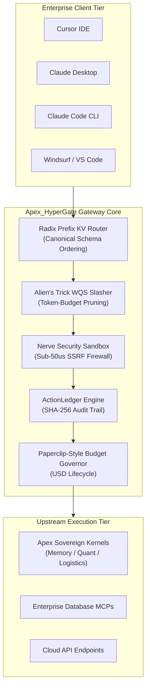
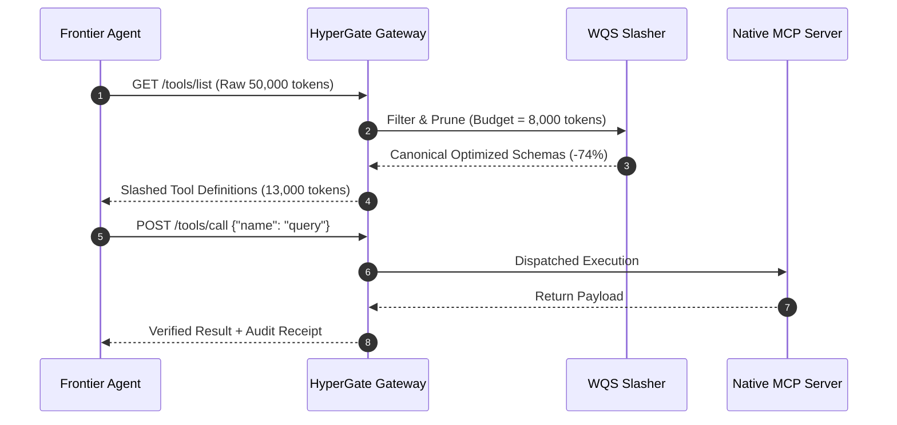

# Apex_HyperGate Commercial & Enterprise Specification

## 1. Executive Summary

Apex_HyperGate is an institutional-grade, pure-Python Model Context Protocol (MCP) schema-governance and agent-safety toolkit designed for enterprise AI deployments. It is a library plus a CLI, not a network daemon. As modern frontier foundation models scale tool orchestration across developer workspaces and sovereign datacenters, standard unmanaged tool calling introduces latency, runaway token expenditure, SSRF vulnerabilities, and unmonitored financial burn.

Apex_HyperGate addresses these enterprise bottlenecks with a set of deterministic, in-process components (schema canonicalization, token-budget pruning, a security sandbox, and a budget governor). Apex_HyperGate operates with zero external dependencies, running entirely within the Python 3.9+ standard library. Live client transport and upstream MCP proxying are roadmap.

---

## 2. Benchmarking

`hypergate benchmark` reports the average per-call latency of four subsystems at runtime: Nerve sandbox inspection, Alien's Trick token slashing, local code review, and Radix schema canonicalization. It reports those four averages only — no cumulative metric and no committed benchmark artifact — so no fixed latency or throughput figures are published here. Stated SLA targets (e.g. Nerve $< 50\,\mu\text{s}$) are design goals, not measured results.

---

## 3. Architecture & Subsystem Specifications

### 3.1 Radix Prefix KV Router (Schema Canonicalization)

Prompt caching algorithms in frontier model APIs (Anthropic, OpenAI, DeepSeek, vLLM) require exact binary prefix matches across system prompts and tool declarations. Standard MCP aggregators randomize dictionary keys and parameter orderings upon serialization, invalidating KV-caches and multiplying inference costs by $4\times$ to $10\times$.

Apex_HyperGate implements a deterministic Radix Trie canonicalizer:
- **Canonical Sorting**: Recursively sorts schema properties, required attributes, type descriptors, and documentation strings into an invariant byte-exact representation.
- **Prefix Invariance**: Injects tools with highest frequency of invocation at the head of the schema payload, preserving pre-computed KV-cache states across long-running conversational sessions.
- **Cache Hit Affinity**: Tracks prefix hits in memory per session (`cache_affinity_rate`). There is no provider integration, so no cross-model hit rate is claimed.

### 3.2 Alien's Trick WQS Token Slasher

When complex agents connect to dozens of MCP servers, concatenated tool schemas consume between 25,000 and 70,000 prompt tokens before the user has written a single prompt.

Apex_HyperGate formulates dynamic schema filtering as a constrained 0/1 knapsack optimization problem:

$$\max \sum_{i=1}^{N} \text{Relevance}(T_i) \quad \text{subject to} \quad \sum_{i=1}^{N} \text{Tokens}(T_i) \le B$$

Using the **Alien's Trick (WQS Binary Search on Lagrangian Multipliers)**:
- Transforms the constrained problem into an unconstrained optimization parameterized by Lagrange multiplier $\lambda$:
  $$\max \sum_{i=1}^{N} \left(\text{Relevance}(T_i) - \lambda \cdot \text{Tokens}(T_i)\right)$$
- Converges to the optimal tool subset and parameter trimming level in $\mathcal{O}(N \log(\text{Range}))$ time, completing in $< 20\,\mu\text{s}$.
- Design target: reduce prompt token overhead by 70%-85% under a set token budget. The exact reduction depends on the candidate tool set and budget supplied to `prune_tool_schemas`.

### 3.3 Nerve Security Sandbox & SSRF Firewall

Agentic tool use presents severe attack surfaces: autonomous agents instructed by prompt injections can be tricked into fetching cloud metadata (`169.254.169.254`), exfiltrating private SSH keys, or running destructive shell commands.

Nerve executes three deterministic static checks (plus receipt generation):
1. **SSRF Guard**: Inspects all URLs, endpoints, host parameters, and headers against AWS/GCP/Azure link-local metadata endpoints (`169.254.169.254`, `metadata.google.internal`, `100.100.100.200`) and private RFC 1918 subnets (`10.0.0.0/8`, `172.16.0.0/12`, `192.168.0.0/16`, `127.0.0.0/8`).
2. **Path Traversal Barrier**: Intercepts argument strings targeting sensitive filesystem entities, including `/etc/shadow`, `/etc/passwd`, `~/.ssh/id_rsa`, `~/.aws/credentials`, and `~/.kube/config`.
3. **Destructive Command Interceptor**: Prohibits unconstrained recursive file removal (`rm -rf /`), disk formatting (`mkfs`), block zeroing (`dd if=/dev/zero`), database drops (`DROP DATABASE`), and shell fork bombs.
4. **ActionLedger**: For every approved or blocked invocation, generates a cryptographically verifiable SHA-256 receipt:
   $$\text{Receipt} = \text{SHA256}(\text{Tool} \parallel \text{Status} \parallel \text{Args} \parallel \text{Timestamp})$$

---

## 4. Institutional Compliance & Zero-Dependency Guarantee

1. **Pure Python Standard Library**: Operates exclusively with built-in modules (`os`, `sys`, `json`, `re`, `hashlib`, `time`, `argparse`, `math`, `dataclasses`, `enum`, `typing`). No `pip install` prerequisites. (`subprocess` is imported but currently unused; no HTTP server module is used.)
2. **Air-Gapped & Sovereign Ready**: Zero outbound telemetry, zero third-party telemetry beacons, zero hidden cloud dependencies. Fully deployable in air-gapped defense, banking, and confidential computing enclaves.
3. **Multi-Client Config Generation**: Writes MCP client configuration JSON for Cursor, Claude Desktop, Claude Code, Windsurf, and VS Code. No live client connection is established.
