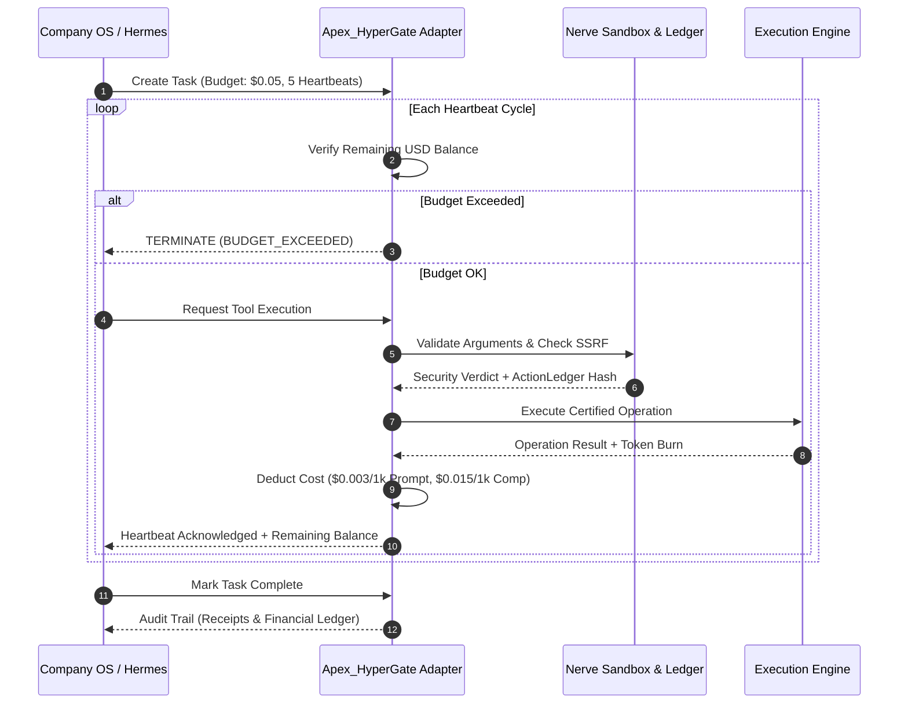
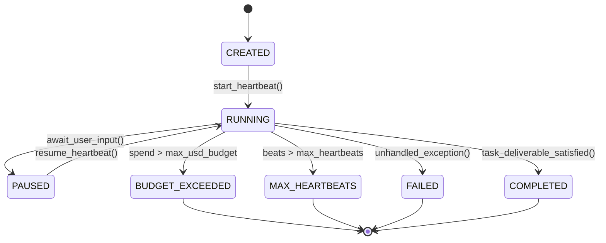

# Hermes Paperclip Adapter & Company OS Integration

## 1. Overview & Architectural Motivation

Paperclip (`@paperclipai/hermes-paperclip-adapter`) introduces an institutional governance framework termed the **Company OS** for autonomous agent execution. In autonomous corporate workflows, agent teams are assigned discrete organizational mandates, allocated hard financial budgets denominated in USD, and supervised through periodic execution cycles called **heartbeats**.

Apex_HyperGate provides first-class native integration with Paperclip Company OS. It mediates every heartbeat, enforces real-time token and USD expenditure ceilings, and emits tamper-evident **ActionLedger** cryptographic audit receipts.



---

## 2. Company OS Task Lifecycle & State Machine

Every autonomous operation in Apex_HyperGate is modeled as a formal state machine governed by the `PaperclipTaskState` primitive:



### State Definitions

- **`CREATED`**: Task initialized with target objective, maximum USD spend limit (`max_usd_budget`), and maximum allowable heartbeat count (`max_heartbeats`).
- **`RUNNING`**: Active execution heartbeat in progress. Tools are invoked, code is written, or analysis is generated.
- **`PAUSED`**: Execution suspended awaiting external human-in-the-loop validation or external system webhook.
- **`BUDGET_EXCEEDED`**: Immediate fail-safe circuit breaker triggered. When `spent_usd > max_usd_budget`, all further tool calls are rejected at gateway line speed.
- **`MAX_HEARTBEATS`**: Preventative halt triggered when the agent exceeds its allocated iteration quota without reaching closure.
- **`COMPLETED`**: Work unit achieved within financial and operational constraints.

---

## 3. Financial Token Accounting & Rate Matrix

Apex_HyperGate maintains real-time USD accounting calibrated to standard frontier model billing:

| Metric | Prompt / Input Pricing | Completion / Output Pricing | Notes |
| :--- | :--- | :--- | :--- |
| **Frontier Model Rates** | $\$3.00 \text{ per } 10^6 \text{ tokens}$ | $\$15.00 \text{ per } 10^6 \text{ tokens}$ | Calibrated to Claude Opus / OpenAI o3 standard |
| **HyperGate Cost Formula** | $\text{Tokens}_{\text{in}} \times 0.000003$ | $\text{Tokens}_{\text{out}} \times 0.000015$ | Computed per heartbeat invocation |

### Mathematical Invariant

$$\text{Spent}_{\text{USD}}^{(t)} = \sum_{k=1}^{t} \left( \frac{\text{PromptTokens}_k}{10^6} \times \$3.00 + \frac{\text{CompletionTokens}_k}{10^6} \times \$15.00 \right) \le \text{Budget}_{\text{Max}}$$

If at any heartbeat $t$ the projected cost exceeds $\text{Budget}_{\text{Max}}$, the adapter halts execution with zero latency and raises a budget exhaustion event.

---

## 4. ActionLedger Cryptographic Receipts

For enterprise auditability, Paperclip mandates non-repudiable logs of all autonomous actions. Apex_HyperGate generates an immutable SHA-256 receipt for every tool interaction:

$$\mathcal{H}_{\text{receipt}} = \text{SHA256}\left(\text{ToolName} \mathbin{\Vert} \text{Verdict} \mathbin{\Vert} \text{SortedArgs} \mathbin{\Vert} \text{Timestamp}\right)$$

Every receipt is recorded in the task's `action_ledger` list and exported upon task completion, providing SOC2/ISO27001-compliant verification that no unauthorized actions or egress breaches occurred.

---

## 5. Python Integration Example

```python
from apex_hypergate.adapters.paperclip_adapter import HermesPaperclipAdapter
from apex_hypergate.core.primitives import PaperclipTaskState

# 1. Initialize Hermes Paperclip Adapter with $0.10 limit
adapter = HermesPaperclipAdapter()
task = adapter.create_task(
    task_id="TASK-PROD-9002",
    goal="Autonomous code migration and test verification",
    max_usd_budget=0.10,
    max_heartbeats=10,
)

# 2. Execute Heartbeat
adapter.start_heartbeat(task.task_id)

# 3. Mediate tool execution through Nerve security sandbox
result = adapter.record_tool_execution(
    task_id=task.task_id,
    tool_name="git_diff_viewer",
    arguments={"target": "HEAD~1"},
    prompt_tokens=450,
    completion_tokens=220,
)

# 4. Finalize Heartbeat
heartbeat_state = adapter.end_heartbeat(task.task_id)
print(f"Task status: {task.state}, Spent: ${task.spent_usd:.4f}")
```
