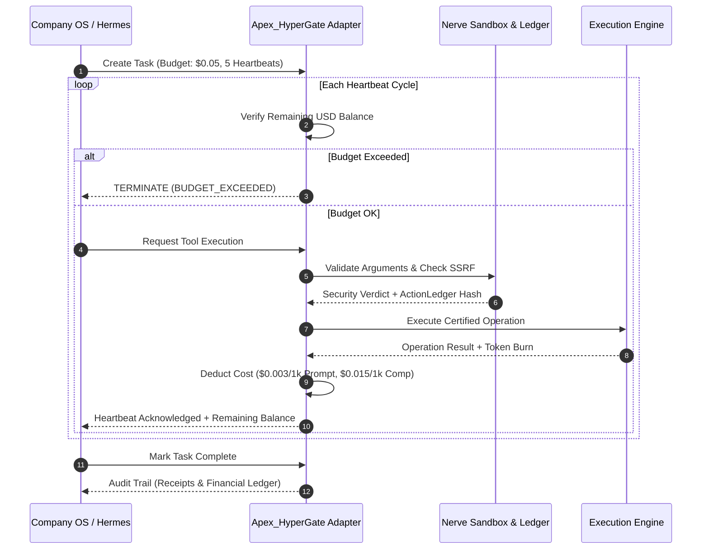
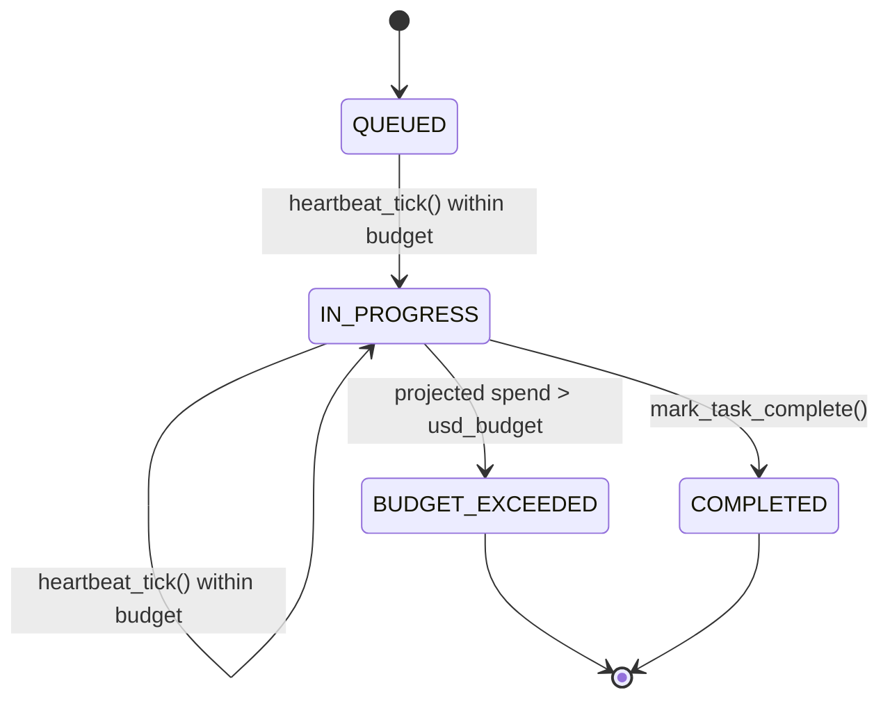

# Hermes Paperclip Adapter & Company OS Integration

## 1. Overview & Architectural Motivation

A **Paperclip-style Company OS** governance model introduces an institutional framework for autonomous agent execution. In autonomous corporate workflows, agent teams are assigned discrete organizational mandates, allocated hard financial budgets denominated in USD, and supervised through periodic execution cycles called **heartbeats**. Apex_HyperGate ships a **local reimplementation** of this model and has **no dependency** on the `@paperclipai/hermes-paperclip-adapter` package.

Apex_HyperGate provides a local, self-contained implementation of this model. It mediates each heartbeat tick, enforces token and USD expenditure ceilings, and emits **ActionLedger**-style SHA-256 audit receipts.



---

## 2. Company OS Task Lifecycle & State Machine

Every autonomous operation in Apex_HyperGate is modeled as a state machine governed by the `PaperclipTask` dataclass and its `PaperclipTaskStatus` enum:



### State Definitions

- **`QUEUED`**: Task created via `create_task(task_id, title, usd_budget)`.
- **`IN_PROGRESS`**: Set after a successful `heartbeat_tick()`. Tokens and USD are accounted and a receipt is emitted.
- **`BUDGET_EXCEEDED`**: Set when a `heartbeat_tick()` would push `consumed_usd` above `usd_budget`; that tick is rejected.
- **`BLOCKED`**: Present in the `PaperclipTaskStatus` enum for a halted task (no transition is wired to it yet).
- **`COMPLETED`**: Set by `mark_task_complete()`.

---

## 3. Financial Token Accounting & Rate Matrix

Apex_HyperGate maintains real-time USD accounting calibrated to standard frontier model billing:

| Metric | Prompt / Input Pricing | Completion / Output Pricing | Notes |
| :--- | :--- | :--- | :--- |
| **Frontier Model Rates** | $\$3.00 \text{ per } 10^6 \text{ tokens}$ | $\$15.00 \text{ per } 10^6 \text{ tokens}$ | Calibrated to Claude Opus / OpenAI o3 standard |
| **HyperGate Cost Formula** | $\text{Tokens}_{\text{in}} \times 0.000003$ | $\text{Tokens}_{\text{out}} \times 0.000015$ | Computed per heartbeat invocation |

### Mathematical Invariant

$$\text{Spent}_{\text{USD}}^{(t)} = \sum_{k=1}^{t} \left( \frac{\text{PromptTokens}_k}{10^6} \times \$3.00 + \frac{\text{CompletionTokens}_k}{10^6} \times \$15.00 \right) \le \text{Budget}_{\text{Max}}$$

If at any heartbeat $t$ the projected cost exceeds $\text{Budget}_{\text{Max}}$, the adapter halts execution with zero latency and raises a budget exhaustion event.

---

## 4. ActionLedger Cryptographic Receipts

For enterprise auditability, Paperclip mandates non-repudiable logs of all autonomous actions. Apex_HyperGate generates an immutable SHA-256 receipt for every tool interaction:

$$\mathcal{H}_{\text{receipt}} = \text{SHA256}\left(\text{ToolName} \mathbin{\Vert} \text{Verdict} \mathbin{\Vert} \text{SortedArgs} \mathbin{\Vert} \text{Timestamp}\right)$$

Every receipt is appended to the task's `receipts` list. No compliance certification is claimed.

---

## 5. Python Integration Example

```python
from apex_hypergate.adapters.paperclip_adapter import HermesPaperclipAdapter

# 1. Initialize the adapter and create a $0.10 budget-governed task
adapter = HermesPaperclipAdapter()
task = adapter.create_task(
    task_id="TASK-PROD-9002",
    title="Autonomous code migration and test verification",
    usd_budget=0.10,
)

# 2. Process one heartbeat tick (accounts USD and emits an ActionLedger receipt)
can_proceed, task, failure_reason = adapter.heartbeat_tick(
    task_id=task.task_id,
    prompt_tokens=450,
    completion_tokens=220,
    tool_action_name="git_diff_viewer",
    tool_payload={"target": "HEAD~1"},
)
if not can_proceed:
    print("Halted:", failure_reason)

print(f"Task status: {task.status.value}, Spent: ${task.consumed_usd:.4f}, Remaining: ${task.remaining_usd:.4f}")

# 3. Mark complete (emits a final closure receipt)
task = adapter.mark_task_complete(task.task_id)
print(f"Receipts: {len(task.receipts)}")
```
